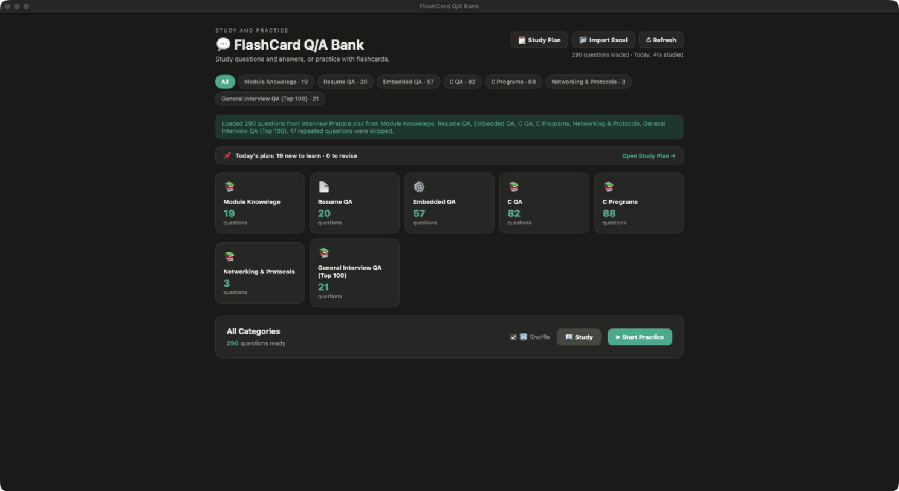
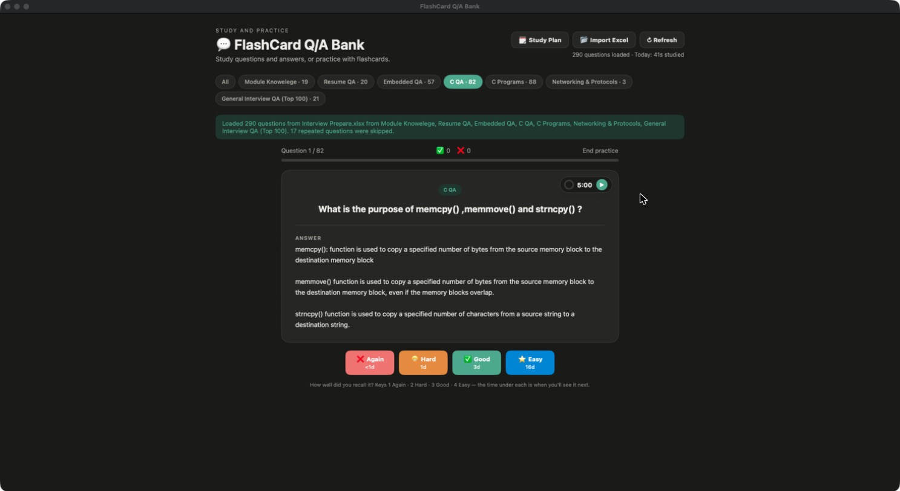
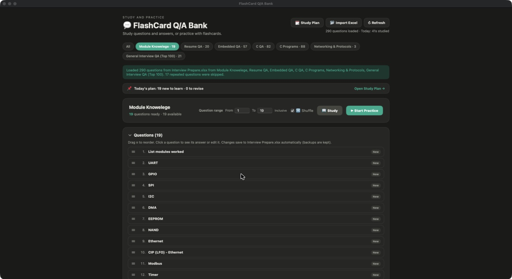

# FlashCards QA Learning

Turn your interview Q&A workbook (Excel, on OneDrive) into a daily study system. You can study and practise flashcards, follow a plan sized to your free time, and review each card just before you'd forget it.

There are two ways to use it:

- **Mac app (recommended):** a native macOS app with a daily plan (FSRS revision first, then your own tasks), card timers, a morning reminder, and question editing that saves to Excel.
- **Web app:** the original React app that runs in your browser. It's simpler: study and practice only.



[What it does](#what-it-does) · [Quick start](#quick-start) · [Use cases](#use-cases) · [Study algorithm](#study-algorithm-fsrs) · [Mac app guide](#mac-app-guide) · [Web app guide](#web-app-guide) · [Workbook format](#workbook-format) · [Data and privacy](#data-and-privacy) · [Development](#development)

## What it does

| | Mac app | Web app |
|---|:---:|:---:|
| Loads the OneDrive workbook on launch, Refresh, Import Excel | ✅ | ✅ |
| Study mode (question + answer) and Practice mode (reveal, then rate) | ✅ | ✅ |
| Category filter, question range, shuffle, retry missed | ✅ | ✅ |
| **FSRS-5 spaced repetition** with Again / Hard / Good / Easy ratings | ✅ | — |
| **Study plan**: today's FSRS revision first, then your own day-by-day task list (paste a written plan) | ✅ | — |
| **Morning reminder**: cards to revise today + your first tasks | ✅ | — |
| **Card timer**: starts on each card; 5/10/15/20/30 min (20 for C Programs and Module Knowledge by default); time logged | ✅ | — |
| **Edit questions**: add, edit (with bold, bullets, numbering), reorder, delete, section dividers, new categories; saved straight to Excel with backups | ✅ | — |
| Code font for C Programs, light and dark mode, keyboard shortcuts | ✅ | — |
| Runs without Terminal or a browser | ✅ | — |

## Quick start

Both versions read the same workbook: `InterviewPrepare.xlsx` (or `Interview Prepare.xlsx`) in
`~/Library/CloudStorage/OneDrive-Personal/Interview/Interview Preparation`. See [Workbook format](#workbook-format) for how to lay out the sheets.

### Option 1 — Mac app (recommended)

**What you need:** macOS 14 or later, and Xcode (or the Xcode command-line tools) to build it.

```bash
cd mac
./build-app.sh --install
```

This builds the app and copies **FlashCards QA** into `/Applications`. Open it from Launchpad or Spotlight. It loads your workbook straight away; you don't need Terminal or a browser after this.

- The first time you open the Study Plan, macOS asks to allow notifications. Allow them to get a morning reminder of what to revise.
- If your workbook is somewhere else, change the folder in **Settings (⌘,) › Workbook folder**.
- To update the app after pulling new code, run `./build-app.sh --install` again. Your progress is kept.
- The build is signed only for your own Mac (it isn't notarized for sharing).

### Option 2 — React web app

**What you need:** [Node.js](https://nodejs.org/) with npm.

From the project folder:

```bash
npm install
```

```bash
npm start
```

This starts a small local service that reads the OneDrive workbook, plus the React app. Open the address shown in Terminal, usually [http://localhost:3002](http://localhost:3002). Keep the Terminal window open while you use it, and press **Ctrl+C** to stop it. After the first time, `npm start` is all you need.

## Use cases

- **Study daily while job hunting:** every morning, clear the cards FSRS says are due, then work through the tasks you wrote for the day, such as "Sorting + linked list + binary search" or "Apply in Coimbatore".
- **Remember answers until the interview:** practise with honest ratings (Again / Hard / Good / Easy). FSRS brings each card back just before you'd forget it, so time goes to weak cards, not ones you already know.
- **Mark what you've learned:** press **Studied** on a card in Study mode. FSRS then schedules it for revision (first in about 3 days); press it again to unmark it.
- **Handle interview or busy days:** do the short revision, then move the day's tasks to tomorrow from each task's ⋯ menu.
- **Practise one topic:** pick a category such as `Embedded QA` or `C Programs`, optionally a range such as questions 10–20, then Study or Practice.
- **Write code from memory:** C Programs cards use a code font with a 20-minute time box; write the program first, then reveal and compare.
- **Track your effort:** see studying and revising time per day, per category and per card, and which cards are slowest.
- **Keep the question bank up to date without opening Excel:** add, edit, reorder or delete questions, group them under section dividers, or create a new category, all from the app. Changes save to the workbook and the plan updates straight away.
- **Use Excel when you prefer:** edit the workbook in Excel, then select **Refresh**.

## Study algorithm (fixed checkpoints + FSRS)

The Mac app runs two methods side by side. Both start the day you study a card:

1. **📅 Fixed checkpoints:** the card is revised **1, 3, 7 and 14 days later**, whatever you rate it. That makes sure every new card gets the same early repetition. Rating a card **Again** restarts its checkpoints from that day. A late review waits at least a day before the next checkpoint.
2. **🧠 FSRS:** from the first study, FSRS also picks a date from how well you remember the card, and every review updates it.

The card comes back on **whichever date is first**. If FSRS brings a card back before its next checkpoint, that review doesn't use up the checkpoint. After the day-14 checkpoint only FSRS is left.

**Fresh start for cards studied so far:** when the checkpoints were introduced, every card you'd already studied became due on that day. Revising it then starts its 1, 3, 7, 14-day checkpoints from that day, with a fresh FSRS history. Its review count and first-study date are kept. You can do the same again at any time with **Settings › Memory › Restart all studied cards on the checkpoints from today…**. You can also turn checkpoints off there to use FSRS alone.

**Telling the two methods apart:** every studied card shows both badges, on the card itself in Study and Practice and in the Study Plan's card lists. The badge for the method that sets the next date is solid, and the other is faded. Hover over the badges to see both dates.

| Badge | Meaning |
|---|---|
| 📅 **Fixed · starts today** / 🧠 **FSRS · starts today** | Revise today to start both methods |
| 📅 **Fixed 2/4 · day 3** (blue) | Next fixed checkpoint; the rating doesn't change its date |
| 🧠 **FSRS · memory ~16d** (purple) | FSRS's own schedule. It's the only badge left after day 14 |

The Study Plan headline and the "Coming up" days split each count into cards due by a 📅 fixed checkpoint and by 🧠 FSRS.


The Mac app schedules reviews with **FSRS-5** (Free Spaced Repetition Scheduler), the algorithm Anki has used by default since 2023.



### How it works

FSRS keeps a small memory model for **each card**:

- **Stability:** how many days the memory lasts before your chance of recalling it drops to 90%.
- **Difficulty:** how hard this card is for you, from 1 to 10.
- **Retrievability:** your chance of recalling it today, which falls the longer you wait.

After you reveal an answer, rate how well you recalled it. Each button shows when you'll see the card next:

| Button | Key | Meaning | First-review gap |
|---|---|---|---|
| ❌ Again | 1 | Forgot it | under 1 day (tomorrow) |
| 😬 Hard | 2 | Recalled with effort | 1 day |
| ✅ Good | 3 | Recalled | 3 days |
| ⭐ Easy | 4 | Instant recall | 16 days |

FSRS updates stability and difficulty from your rating and schedules the next review for when your recall would drop to your **target recall** (90% by default; change it in **Settings › Memory**). Every successful review stretches the gap (for example 3 → 11 → 30+ days). A forgotten card comes back the next day.

### Why FSRS

| Approach | How it decides the next review | Drawback |
|---|---|---|
| Fixed steps (Leitner: 1, 3, 7, 16 days…) | The same gaps for every card | Ignores how hard each card is for you |
| SM-2 (older Anki, SuperMemo) | A per-card "ease" factor | Cards can get stuck reviewing too often ("ease hell") |
| **FSRS-5** | Models each card's memory and predicts your chance of recall | Needs honest ratings |

- **More accurate:** in open benchmarks on millions of real reviews, FSRS predicts recall better than SM-2.
- **Fewer reviews:** it needs about 20–30% fewer reviews for the same recall, which matters when you're also job hunting.
- **Your choice of recall:** you set the recall level directly, for example 90%, instead of tuning obscure multipliers.

It's built on long-standing memory research: the **spacing effect** (reviews spread over growing gaps beat cramming), **retrieval practice** (recalling an answer beats re-reading it, so new cards end with **Test yourself**), and **interleaving** (due cards from different categories are mixed).

### Rules worth knowing

- **Mastered:** FSRS expects you to still recall the card three weeks later (stability ≥ 21 days).
- **Weak:** forgotten twice or more, or rated very difficult. FSRS already brings weak cards back sooner.
- **Practice only:** answering a card that isn't due yet (for example from a category on the start screen) doesn't change its schedule. The card tells you so after you reveal the answer.
- **New cards:** a new card joins the schedule when you mark it **Studied** (an FSRS Good rating) or rate it in **Test yourself**.

## Mac app guide

### Main page

- Pick **All** or a category, then **Study** or **Start Practice**. You can set an inclusive **From/To** range and turn **Shuffle** on or off.
- **📌 Today** shows how many cards are due for revision and how many tasks are left in today's plan, and links to the Study Plan.
- **⌘R** refreshes the workbook, **⌘O** imports another `.xlsx`, and **⌘L** opens the Study Plan.

### Study and Practice

- **Study:** shows the question and answer together. Use ← / → to move. The last card offers **✍️ Test yourself**, which practises the cards you just read.
- **Studied** (key **S**): a toggle on every Study card. When it's set (filled green ✓ Studied), the card joins your schedule: it's revised on days 1, 3, 7 and 14, and FSRS schedules it from the same day (whichever date is first). Press it again to unmark it: the card becomes new again. If the card already has practice history, you're asked to confirm first.
- **✏️ Edit** (key **E**): edit the question and answer without leaving Study. The answer editor has **Bold** (⌘B), **bulleted list** and **numbered list** buttons, and saves to the workbook.
- **Practice:**
  - **Space** reveals the answer, **1–4** rate it, **S** skips, **Esc** ends.
  - **Results** lists the cards you **forgot** and the **shaky** (Hard) ones. **Retry missed** practises the forgotten ones again.
- **C Programs:** shown in a code font, with a reminder to write the code yourself before revealing the answer.

### Card timer

Every card in Study and Practice has a timer in its corner. It **starts by itself** when a card opens. The default time is **20 minutes for C Programs and Module Knowledge** and **5 minutes for other Q&A**. Select the time on the timer to choose 5, 10, 15, 20 or 30 minutes for that category; Settings has the same choice for every category.

- **Pause and resume:** select ⏸/▶ or press **⌥Space**. Moving to another card starts that card's timer.
- **Overtime:** when the time runs out, a sound plays and the timer turns red and counts overtime (`+1:20`).
- **Logging:** time counts as **Studying** in Study mode and **Revising** in Practice, and is kept per category and per card. Time while the Mac sleeps isn't counted.
- **Breaks:** after 50 minutes of timed work, the app suggests a 10-minute break.

### Study plan

Open it with **🗓 Study Plan** or **⌘L**. It has two parts, in the order you work through them.

**1 · Revise first.** All your FSRS revision is in this one section.
- **Headline:** how many cards FSRS wants you to revise today (overdue ones included) and the estimated time. **🔁 Start revision** practises all of them, mixed across categories. Once they're done, it shows "✅ Revision done".
- **Coming up:** how many cards are due on each of the next 7 days, so you can see busy days ahead.
- **By category:** a table with, for each category, cards studied (in your FSRS schedule) out of the total, due today, due in the next 7 days, mastered and weak, plus a totals row. Its "Due today" numbers add up to the headline.
  - **▶ Revise (n)** on a row revises just that category's due cards.
  - Selecting a category lists each studied card with its last rating, how long FSRS expects you to remember it, and when it comes back.

**2 · Your plan.** This is your own task list for each day. Use ◀ ▶ to move between days.
- **Add a task:** type it and press Return. Examples: "Daily two modules", "All sorting in C Programs + linked list + binary search", "Apply in Coimbatore".
- **Edit:** double-click a task. Tick it off when it's done, and drag ≡ to reorder.
- **▶ Start:** a task that names a category (such as "Resume QA") is linked to it automatically and gets a **▶ Start** button that opens those questions in Study mode. Use the 🔗 menu to link a task to a category or to one of its section dividers, or to remove the link.
- **⋯ menu:** move a task to tomorrow or today, or delete it.
- **Unfinished from earlier:** tasks you didn't finish on earlier days appear at the top of Today, with **→ Today** or **Move all to today**.
- **📋 Paste plan…:** paste a written plan like this one. Each date line starts a day, and the lines under it become that day's tasks:

  ```text
  [Nov 25 ]
  Revise as per algo
  Daily two modules
  Embedded C program (Add new 30)
  Apply in Coimbatore

  [Nov 26 ]
  All Sorting in C Program + linked list + Binary search
  ```

  "Revise as per algo" lines are skipped, because part 1 already handles revision. Dates such as `[Nov 25]`, `25 Nov`, `25th November` and `2026-11-25` are all understood.

**3 · Study notes.** Your own notes for the whole preparation, such as which phase you're in and what each phase covers. Select **✏️ Edit notes** (or double-click the notes), write freely and press **Save** (⌘S). A line starting with `*` or `-` becomes a bullet, and a line just above bullets becomes a heading. The notes are saved with your progress, not in the workbook.

Further down you'll find how FSRS schedules your reviews and your study time (today, the last 7 days and all time; a 14-day chart; the average time per card; your slowest cards).

**Morning reminder:** each morning (9:00 by default; change it in **Settings › Reminder**) a notification tells you how many cards to revise and lists your first tasks.

### Editing questions



Select a category, then expand **Questions (N)** below Study / Start Practice. It's collapsed by default.

- **Reorder:** drag ≡ onto another row. The rows move in Excel, together with any extra columns.
- **View and edit:** select a question to see its answer, then **✏️ Edit**. The answer editor has **Bold** (⌘B), **bulleted list** and **numbered list** buttons. It saves automatically about 1.5 seconds after you stop typing.
- **Add:** **＋ Add question** adds a row at the end of that category's sheet.
- **Delete:** **🗑 Delete** asks for confirmation, then removes the row with no gap left behind.
- **Section dividers:** **＋ Divider** (next to **＋ Add question**) adds a divider such as "Arrays" or "Linked Lists" to group the questions you learn together.
  - **Rename:** double-click a divider, then press Return.
  - **Move:** drag its ≡ handle anywhere between questions.
  - **Delete:** use the ⋯ menu.
  - **How it's stored:** a divider is a row whose question cell starts with `## ` (for example `## Arrays`). It moves with the questions in Excel, and it's never studied as a card. The web app skips these rows too.
- **New category:** **＋ Add category** (after the category chips on the main page) adds a new tab to the workbook with `QA` in A1. The new category opens with its question list ready for the first question. Names follow Excel's tab rules: up to 31 characters, none of `[ ] : * ? / \`, and not already used.

Changes save straight to the workbook the questions came from, and the study plan updates. Edited questions keep their review history, and duplicate questions aren't allowed.

**Safety:**
- **Backups:** before saving, a backup goes to `~/Library/Application Support/FlashCardsQA/backups/` (at most one every 5 minutes; the last 30 are kept).
- **Workbook open in Excel:** the app waits and saves once you close it there.
- **Checked before replacing:** each saved file is checked to still open as a valid workbook before it replaces the original.
- **What changes:** only the edited question and answer cells. Bold is saved as real Excel bold, and bold you added in Excel shows bold in the app. Other sheets and formatting are kept.
- **File type:** only `.xlsx` files can be edited. `.xls` files are read-only.

### Keyboard shortcuts

| Where | Keys |
|---|---|
| Anywhere | ⌘R Refresh · ⌘O Import Excel · ⌘L Study Plan · ⌘, Settings · ⌥Space start/pause the card timer |
| Study | ← / → Previous / Next · S Studied on/off · E Edit · Esc back |
| Practice | Space reveal · 1–4 Again / Hard / Good / Easy (K = Good, P = Again) · S skip · Esc end |

## Web app guide


The web app covers studying and practising. It doesn't have the study plan, FSRS, timers or editing.

1. Choose **All** or a category. For a category, you can set an inclusive **From/To** range, and choose whether to **Shuffle**.
2. **Study:** read each question with its answer, using **Previous / Next**.
3. **Start Practice:** **Reveal Answer**, then mark **I knew it** or **Practice again**, or skip.
4. At the end, review the missed questions and **Retry** them, **Restart**, or go back to the categories.
5. Use **Refresh** after editing the workbook in Excel, or **Import Excel** to load another `.xlsx` or `.xls` file for that session.

The web app only reads the workbook and never writes to it.

## Workbook format

- **Which sheets load:** only sheets whose cell **A1** contains `QA` (case-insensitive, also `Q&A` or `Q/A`). Each one becomes a category named after its tab; other tabs are ignored.
- **Layout:** below A1, put each **question in column A** and its **answer in column B**. Optional `Question` / `Answer` header rows are recognised, and those columns can be anywhere.
- **Duplicates:** repeated question text is skipped, so each question appears once.
- **Section dividers:** rows whose question starts with `##` (for example `## Arrays`) are section headings, not questions.
- **Filename:** `InterviewPrepare.xlsx` and `Interview Prepare.xlsx` are both recognised. **Import Excel** loads any other workbook that follows the same rules.

## Data and privacy

- **Everything stays on your Mac.** The apps read the workbook from your local OneDrive folder; nothing is uploaded anywhere.
- **Mac app progress** (review history, plan, time, settings) is saved in `~/Library/Application Support/FlashCardsQA/progress.json`, separate from the workbook. Cards are matched by their question text, so history survives Refresh, Import, reordered rows and renamed tabs.
- **The workbook stays the source of truth for questions.** The Mac app writes to it only when you add, edit, reorder or delete questions, and keeps backups. The web app never writes to it.

## Development

| Path | What's there |
|---|---|
| `src/`, `server.js`, `start.js` | React web app and its local workbook reader (Node) |
| `mac/Sources/FlashCardsCore/` | Mac app logic: workbook reader and writer, FSRS, revision outlook, plan-text parser, progress storage |
| `mac/Sources/FlashCardsQA/` | SwiftUI app: screens, card timer, reminders |
| `mac/Tests/` | Unit tests for the parser, FSRS, planner, workbook writer and storage |

**Mac app:**
- Run the tests with `cd mac && swift test`.
- Rebuild with `./build-app.sh` (add `--install` to copy it to `/Applications`).
- To work in Xcode, open `mac/Package.swift`.

**Web app:**
- Run the tests with `npm test`.
- Make a production build with `npm run build`.
