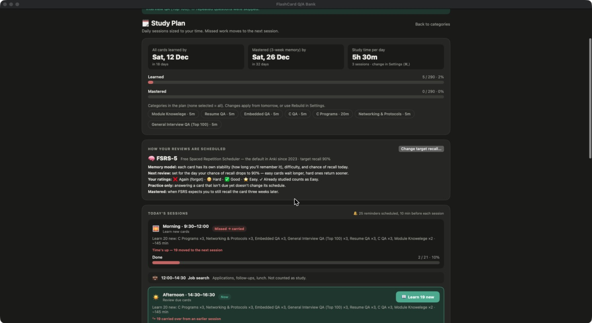

# FlashCards QA Learning

Turn your interview Q&A workbook (Excel, on OneDrive) into a daily study system. You can study and practise flashcards, follow a plan sized to your free time, and review each card just before you'd forget it.

There are two ways to use it:

- **Mac app (recommended):** a native macOS app with the study plan, the FSRS memory algorithm, card timers, session reminders, and question editing that saves to Excel.
- **Web app:** the original React app that runs in your browser. It's simpler: study and practice only.


[What it does](#what-it-does) · [Quick start](#quick-start) · [Use cases](#use-cases) · [Study algorithm](#study-algorithm-fsrs) · [Mac app guide](#mac-app-guide) · [Web app guide](#web-app-guide) · [Workbook format](#workbook-format) · [Data and privacy](#data-and-privacy) · [Development](#development)

## What it does

| | Mac app | Web app |
|---|:---:|:---:|
| Loads the OneDrive workbook on launch, Refresh, Import Excel | ✅ | ✅ |
| Study mode (question + answer) and Practice mode (reveal, then rate) | ✅ | ✅ |
| Category filter, question range, shuffle, retry missed | ✅ | ✅ |
| **FSRS-5 spaced repetition** with Again / Hard / Good / Easy ratings | ✅ | — |
| **Study plan**: daily sessions, carry-over of missed work, finish-date estimate, 14-day outlook | ✅ | — |
| **Reminders** before each study session | ✅ | — |
| **Card timer**: 5 min per Q&A, 20 min per C program; studying and revising time logged | ✅ | — |
| **Edit questions**: add, edit, reorder, delete, saved straight to Excel with backups | ✅ | — |
| Code font for C Programs, light and dark mode, keyboard shortcuts | ✅ | — |
| Runs without Terminal or a browser | ✅ | — |

## Quick start

Both versions read the same workbook: `InterviewPrepare.xlsx` (or `Interview Prepare.xlsx`) in
`~/Library/CloudStorage/OneDrive-Personal/Interview/Interview Preparation`. See [Workbook format](#workbook-format) for how to lay out the sheets.

### Option 1 — Mac app (recommended)

**What you need:** macOS 14 or later, and Xcode (or the Xcode command-line tools) to build it.

```bash
cd mac
./build-app.sh --install
```

This builds the app and copies **FlashCards QA** into `/Applications`. Open it from Launchpad or Spotlight. It loads your workbook straight away; you don't need Terminal or a browser after this.

- The first time you open the Study Plan, macOS asks to allow notifications. Allow them to get reminders before each session.
- If your workbook is somewhere else, change the folder in **Settings (⌘,) › Workbook folder**.
- To update the app after pulling new code, run `./build-app.sh --install` again. Your progress is kept.
- The build is signed only for your own Mac (it isn't notarized for sharing).

### Option 2 — React web app

**What you need:** [Node.js](https://nodejs.org/) with npm.

From the project folder:

```bash
npm install
```

```bash
npm start
```

This starts a small local service that reads the OneDrive workbook, plus the React app. Open the address shown in Terminal, usually [http://localhost:3002](http://localhost:3002). Keep the Terminal window open while you use it, and press **Ctrl+C** to stop it. After the first time, `npm start` is all you need.

## Use cases

- **Study daily while job hunting:** set your free time as morning, afternoon and evening sessions. The plan gives each session a target, moves missed work to the next session, and shows when you'll have learned everything.
- **Remember answers until the interview:** practise with honest ratings (Again / Hard / Good / Easy). FSRS brings each card back just before you'd forget it, so time goes to weak cards, not ones you already know.
- **Skip what you already know:** mark known cards **✓ Already studied** so they're scheduled weeks out and stay off today's list.
- **Handle interview or busy days:** **Busy today** moves the day's work to tomorrow and updates the finish date.
- **Practise one topic:** pick a category such as `Embedded QA` or `C Programs`, optionally a range such as questions 10–20, then Study or Practice.
- **Write code from memory:** C Programs cards use a code font with a 20-minute time box; write the program first, then reveal and compare.
- **Track your effort:** see studying and revising time per day, per category and per card, and which cards are slowest.
- **Keep the question bank up to date without opening Excel:** add, edit, reorder or delete questions from the app. Changes save to the workbook and the plan updates straight away.
- **Use Excel when you prefer:** edit the workbook in Excel, then select **Refresh**.

## Study algorithm (FSRS)

The Mac app schedules reviews with **FSRS-5** (Free Spaced Repetition Scheduler), the algorithm Anki has used by default since 2023.


### How it works

FSRS keeps a small memory model for **each card**:

- **Stability:** how many days the memory lasts before your chance of recalling it drops to 90%.
- **Difficulty:** how hard this card is for you, from 1 to 10.
- **Retrievability:** your chance of recalling it today, which falls the longer you wait.

After you reveal an answer, rate how well you recalled it. Each button shows when you'll see the card next:

| Button | Key | Meaning | First-review gap |
|---|---|---|---|
| ❌ Again | 1 | Forgot it | under 1 day (tomorrow) |
| 😬 Hard | 2 | Recalled with effort | 1 day |
| ✅ Good | 3 | Recalled | 3 days |
| ⭐ Easy | 4 | Instant recall | 16 days |

FSRS updates stability and difficulty from your rating and schedules the next review for when your recall would drop to your **target recall** (90% by default; change it in **Settings › Memory**). Every successful review stretches the gap (for example 3 → 11 → 30+ days). A forgotten card comes back the next day.

### Why FSRS

| Approach | How it decides the next review | Drawback |
|---|---|---|
| Fixed steps (Leitner: 1, 3, 7, 16 days…) | The same gaps for every card | Ignores how hard each card is for you |
| SM-2 (older Anki, SuperMemo) | A per-card "ease" factor | Cards can get stuck reviewing too often ("ease hell") |
| **FSRS-5** | Models each card's memory and predicts your chance of recall | Needs honest ratings |

- **More accurate:** in open benchmarks on millions of real reviews, FSRS predicts recall better than SM-2.
- **Fewer reviews:** it needs about 20–30% fewer reviews for the same recall, which matters when you're also job hunting.
- **Your choice of recall:** you set the recall level directly, for example 90%, instead of tuning obscure multipliers.

It's built on long-standing memory research: the **spacing effect** (reviews spread over growing gaps beat cramming), **retrieval practice** (recalling an answer beats re-reading it, so new cards end with **Test yourself**), and **interleaving** (due cards from different categories are mixed).

### Rules worth knowing

- **Mastered:** FSRS expects you to still recall the card three weeks later (stability ≥ 21 days).
- **Weak:** forgotten twice or more, or rated very difficult. FSRS already brings weak cards back sooner.
- **Practice only:** answering a card that isn't due yet (for example from a category on the start screen) doesn't change its schedule. The card tells you so after you reveal the answer.
- **New cards:** a new card joins the schedule after its first rating in **Test yourself**. **✓ Already studied** counts as an Easy rating.

## Mac app guide

### Main page

- Pick **All** or a category, then **Study** or **Start Practice**. You can set an inclusive **From/To** range and turn **Shuffle** on or off.
- **📌 Today's plan** shows what's left today and links to the Study Plan.
- **⌘R** refreshes the workbook, **⌘O** imports another `.xlsx`, and **⌘L** opens the Study Plan.

### Study and Practice

- **Study:** shows the question and answer together. Use ← / → to move. The last card offers **✍️ Test yourself**, which practises the cards you just read.
- **✓ Already studied** (key **A**): for new cards you already know. It counts as done today and comes back in about 16 days.
- **Practice:**
  - **Space** reveals the answer, **1–4** rate it, **S** skips, **Esc** ends.
  - **Results** lists the cards you **forgot** and the **shaky** (Hard) ones. **Retry missed** practises the forgotten ones again.
- **C Programs:** shown in a code font, with a reminder to write the code yourself before revealing the answer.

### Card timer

Every card in Study and Practice has a timer in its corner. It's ready at **5 minutes for Q&A** and **20 minutes for C Programs** (you can set a time for each category in Settings).

- **Start and pause:** select ▶ or press **⌥Space**. Moving to another card stops the timer.
- **Overtime:** when the time runs out, a sound plays and the timer turns red and counts overtime (`+1:20`).
- **Logging:** time counts as **Studying** in Study mode and **Revising** in Practice, and is kept per category and per card. Time while the Mac sleeps isn't counted.
- **Breaks:** after 50 minutes of timed work, the app suggests a 10-minute break.

### Study plan



The plan has no deadline. It sizes each day to your sessions and estimates when you'll finish.

| Session (default) | Time | Focus |
|---|---|---|
| 🌅 Morning | 9:30–12:00 | Learn new cards: read them, then **Test yourself** |
| 💼 Job search | 12:00–14:30 | Applications and lunch (not counted as study) |
| ☀️ Afternoon | 14:30–16:30 | Review due cards |
| 🌙 Evening | 19:30–20:30 | Review due cards the afternoon didn't fit |

- **Targets:**
  - Each session gets a target when the day starts, for example "Learn 8 new: C Programs ×2, C QA ×6 · ~70 min".
  - New cards rotate across categories.
  - Time estimates use your card time boxes, then your real average once a category has 10 timed cards.
- **Carry-over:** when a session ends with work left, the rest moves to the next session (or to tomorrow), marked **↪ carried**. **Busy today** moves everything to tomorrow.
- **Finish estimate:** **All cards learned by** and **Mastered by** dates. If you fall behind, the page shows how many days the date has slipped.
- **Progress:** overall Learned and Mastered bars, a New / Learning / Mastered bar for each category, and the weak-card count.
- **Next 14 days:** new and review counts per session, the estimated time, and carried work.
- **Reminders:** a notification 10 minutes before each session (you can change this) says what to cover.
- **Study time:** totals for today, the last 7 days and all time; a 14-day chart; the average time per card; and your slowest cards.

Session times, focus, the reminder lead time, the time per category and the target recall are all in **Settings (⌘,)**.

### Editing questions


Select a category, then expand **Questions (N)** below Study / Start Practice. It's collapsed by default.

- **Reorder:** drag ≡ onto another row. The rows move in Excel, together with any extra columns.
- **View and edit:** select a question to see its answer, then **✏️ Edit**. It saves automatically about 1.5 seconds after you stop typing.
- **Add:** **＋ Add question** adds a row at the end of that category's sheet.
- **Delete:** **🗑 Delete** asks for confirmation, then removes the row with no gap left behind.

Changes save straight to the workbook the questions came from, and the study plan updates. Edited questions keep their review history, and duplicate questions aren't allowed.

**Safety:**
- **Backups:** before saving, a backup goes to `~/Library/Application Support/FlashCardsQA/backups/` (at most one every 5 minutes; the last 30 are kept).
- **Workbook open in Excel:** the app waits and saves once you close it there.
- **Checked before replacing:** each saved file is checked to still open as a valid workbook before it replaces the original.
- **What changes:** only the edited question and answer cells. They're saved as plain text, and other sheets and formatting are kept.
- **File type:** only `.xlsx` files can be edited. `.xls` files are read-only.

### Keyboard shortcuts

| Where | Keys |
|---|---|
| Anywhere | ⌘R Refresh · ⌘O Import Excel · ⌘L Study Plan · ⌘, Settings · ⌥Space start/pause the card timer |
| Study | ← / → Previous / Next · A Already studied · Esc back |
| Practice | Space reveal · 1–4 Again / Hard / Good / Easy (K = Good, P = Again) · S skip · Esc end |

## Web app guide


The web app covers studying and practising. It doesn't have the study plan, FSRS, timers or editing.

1. Choose **All** or a category. For a category, you can set an inclusive **From/To** range, and choose whether to **Shuffle**.
2. **Study:** read each question with its answer, using **Previous / Next**.
3. **Start Practice:** **Reveal Answer**, then mark **I knew it** or **Practice again**, or skip.
4. At the end, review the missed questions and **Retry** them, **Restart**, or go back to the categories.
5. Use **Refresh** after editing the workbook in Excel, or **Import Excel** to load another `.xlsx` or `.xls` file for that session.

The web app only reads the workbook and never writes to it.

## Workbook format

- **Which sheets load:** only sheets whose cell **A1** contains `QA` (case-insensitive, also `Q&A` or `Q/A`). Each one becomes a category named after its tab; other tabs are ignored.
- **Layout:** below A1, put each **question in column A** and its **answer in column B**. Optional `Question` / `Answer` header rows are recognised, and those columns can be anywhere.
- **Duplicates:** repeated question text is skipped, so each question appears once.
- **Filename:** `InterviewPrepare.xlsx` and `Interview Prepare.xlsx` are both recognised. **Import Excel** loads any other workbook that follows the same rules.

## Data and privacy

- **Everything stays on your Mac.** The apps read the workbook from your local OneDrive folder; nothing is uploaded anywhere.
- **Mac app progress** (review history, plan, time, settings) is saved in `~/Library/Application Support/FlashCardsQA/progress.json`, separate from the workbook. Cards are matched by their question text, so history survives Refresh, Import, reordered rows and renamed tabs.
- **The workbook stays the source of truth for questions.** The Mac app writes to it only when you add, edit, reorder or delete questions, and keeps backups. The web app never writes to it.

## Development

| Path | What's there |
|---|---|
| `src/`, `server.js`, `start.js` | React web app and its local workbook reader (Node) |
| `mac/Sources/FlashCardsCore/` | Mac app logic: workbook reader and writer, FSRS, session planner, progress storage |
| `mac/Sources/FlashCardsQA/` | SwiftUI app: screens, card timer, reminders |
| `mac/Tests/` | Unit tests for the parser, FSRS, planner, workbook writer and storage |

**Mac app:**
- Run the tests with `cd mac && swift test`.
- Rebuild with `./build-app.sh` (add `--install` to copy it to `/Applications`).
- To work in Xcode, open `mac/Package.swift`.

**Web app:**
- Run the tests with `npm test`.
- Make a production build with `npm run build`.
